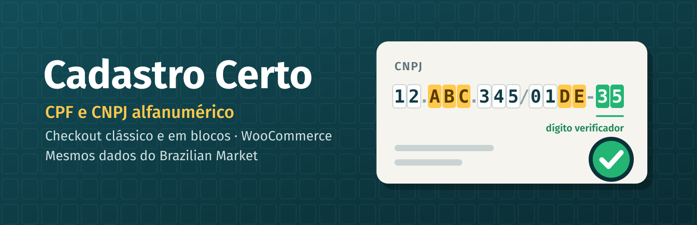
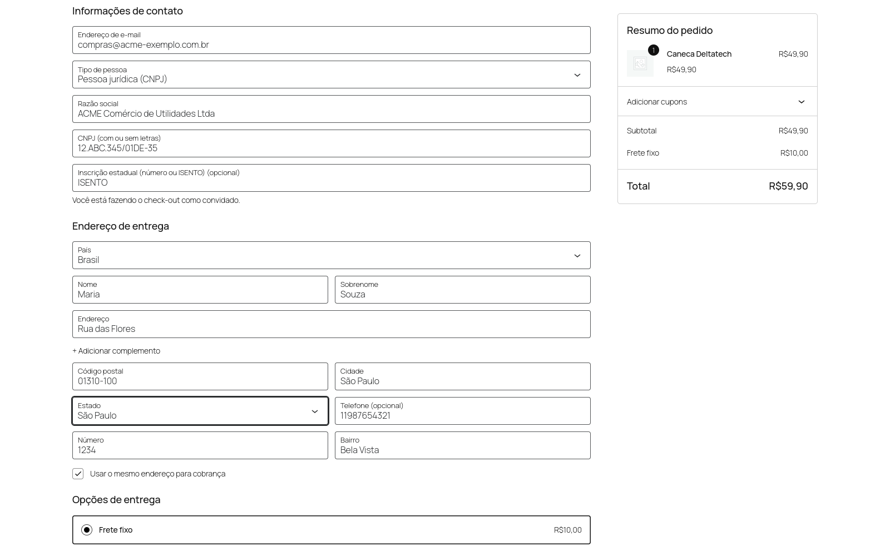
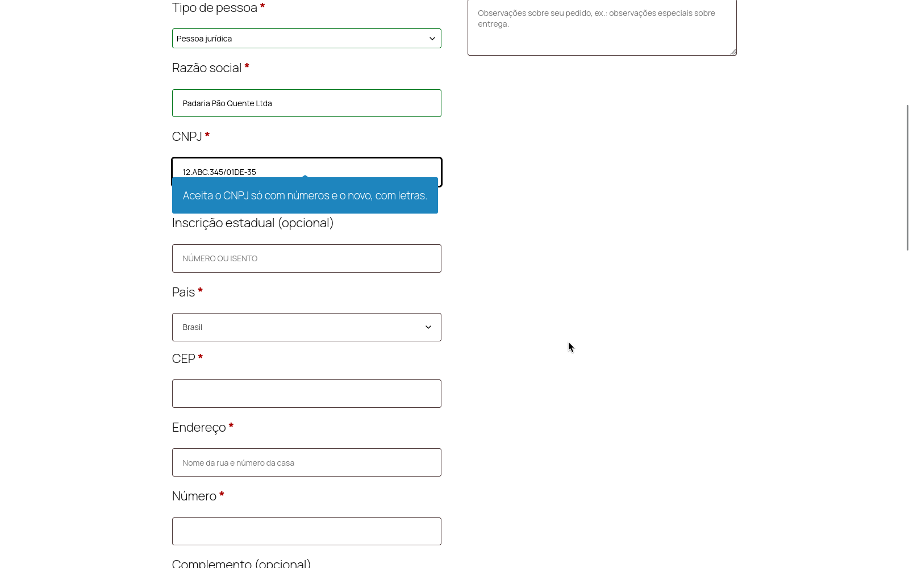
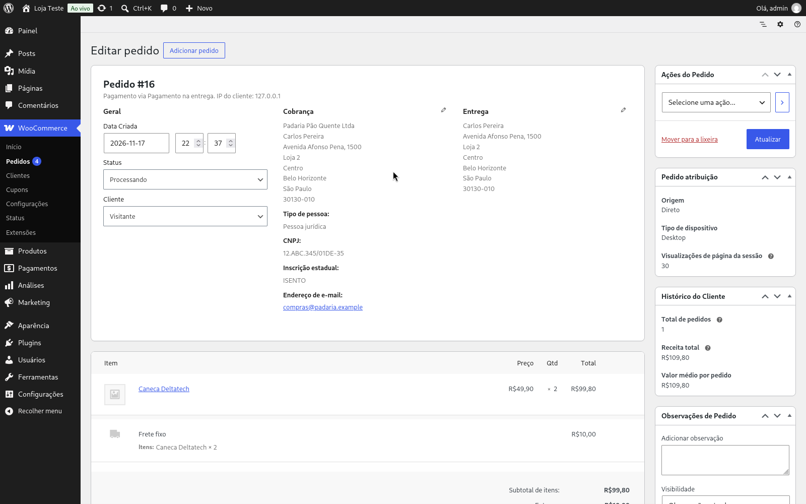

# Cadastro Certo – CPF e CNPJ Alfanumérico for WooCommerce

Plugin gratuito (GPL-2.0-or-later) da [Deltatech](https://www.deltatech.network/) para lojas WooCommerce no Brasil.

O Cadastro Certo põe no WooCommerce os campos que uma loja brasileira precisa: tipo de pessoa, CPF, CNPJ, razão social, inscrição estadual, número e bairro. Funciona no checkout clássico e no checkout em blocos, que é o padrão das lojas novas.

**CNPJ alfanumérico.** Desde julho de 2026 a Receita Federal emite CNPJ com letras (por exemplo, 12.ABC.345/01DE-35). Validação que só aceita números recusa esses clientes. Aqui o dígito verificador é calculado pela regra oficial (valor do caractere = código ASCII menos 48, módulo 11), e o CNPJ só com números continua valendo do mesmo jeito.

**Checkout em blocos.** Os campos usam a API de campos adicionais do próprio WooCommerce. CPF aparece para pessoa física, CNPJ, razão social e inscrição estadual para pessoa jurídica, e o servidor confere tudo de novo antes de criar o pedido.

**Os mesmos dados do plugin antigo.** Tudo é gravado nas chaves que o Brazilian Market on WooCommerce usava: `_billing_cpf`, `_billing_cnpj`, `_billing_persontype`, `_billing_ie`, `_billing_number`, `_billing_neighborhood`, `_billing_cellphone`, `_shipping_number`, `_shipping_neighborhood` no pedido, e as mesmas sem o "_" no cadastro do cliente. Isso vale também para pedidos feitos pelo checkout em blocos. Gateways de pagamento, emissores de nota e ERPs que já liam essas chaves continuam lendo.

## O que vem no plugin

* Tipo de pessoa: física, jurídica ou as duas (o cliente escolhe).
* CPF e CNPJ (numérico e alfanumérico) com dígito verificador.
* Razão social e inscrição estadual (não pedir, opcional ou obrigatória; aceita ISENTO).
* Número e bairro no endereço de cobrança e de entrega.
* Celular, data de nascimento e sexo, se você ligar (vêm desligados).
* Máscaras de CPF, CNPJ (com letras), celular e data.
* Opção para não exigir documento de quem compra de fora do Brasil.
* Endereço no formato brasileiro (rua, número, complemento, bairro) nos e-mails, na tela do pedido e em "Minha conta".
* Campos editáveis na tela do pedido e no perfil do cliente no painel.
* Os mesmos campos na API REST de pedidos e clientes (`billing.cpf`, `billing.cnpj`, `billing.number`…), com os nomes e formatos que o plugin antigo usava.
* Compatível com o armazenamento de pedidos em tabelas próprias (HPOS).

Nenhum recurso expira nem é bloqueado. O plugin não se conecta a nenhum serviço externo e não coleta dados.

## Capturas

Checkout em blocos, pessoa jurídica com CNPJ alfanumérico:

Checkout clássico: CNPJ digitado em minúsculas e formatado pela máscara:

Tela do pedido no painel, com tipo de pessoa, CNPJ, inscrição estadual, número e bairro:

## Instalação

O plugin ainda não está no diretório do WordPress.org (o envio está em revisão). Até lá, instale pelo zip do release:

1. Baixe `cadastro-certo-cpf-cnpj.zip` na [página de releases](https://github.com/Nandcoding/cadastro-certo-cpf-cnpj/releases/latest) (o arquivo anexado, não o "Source code").
2. No painel do WordPress, vá em Plugins > Adicionar novo > Enviar plugin, escolha o zip e ative.
3. Vá em WooCommerce > Configurações > CPF e CNPJ e escolha o que pedir.
4. Pronto: os campos aparecem no checkout clássico e no checkout em blocos.

Requisitos: WordPress 6.7+, WooCommerce 9.9+, PHP 7.4+.

Se o Brazilian Market on WooCommerce estiver ativo, o Cadastro Certo fica em espera, para não repetir campos, e mostra um aviso na tela de plugins com o botão "Assumir os campos e desativar o plugin antigo". Ao assumir, ele copia a configuração do antigo e o desativa; nenhum dado é apagado.

## Limites conhecidos

* **Checkout em blocos:** os documentos ficam na seção "Informações de contato" (é onde a API de campos adicionais do WooCommerce põe campos que não se repetem na entrega). Número e bairro ficam no formulário de endereço, depois dos campos padrão (a API não deixa colocá-los entre os campos do WooCommerce).
* **Checkout em blocos:** o cartão-resumo de um endereço já salvo mostra rua, complemento, cidade e CEP, mas não número e bairro: o WooCommerce monta esse cartão no navegador e só conhece os campos dele. Número e bairro aparecem ao clicar em "Editar" e saem no pedido, nos e-mails e no painel.
* **Checkout em blocos:** o tipo de pessoa começa sem escolha; até o cliente escolher, aparecem CPF e CNPJ.
* **Checkout em blocos:** número e bairro são obrigatórios para qualquer país (o campo de bairro segue a configuração).
* **"Minha conta":** documentos em "Detalhes da conta"; número e bairro em "Endereços".
* As regras de exibição por tipo de pessoa no checkout em blocos precisam do WooCommerce 9.9 ou mais novo.
* Com o Brazilian Market on WooCommerce ativo, o Cadastro Certo fica em espera; nesse tempo o checkout em blocos fica sem campos brasileiros (o antigo não tem suporte a blocos).
* A inscrição estadual é conferida só na forma (números ou ISENTO), não pela regra de cada estado.

## Perguntas frequentes

### Vim do Brazilian Market on WooCommerce: perco meus dados?

Não. O Cadastro Certo lê e grava as mesmas chaves (`_billing_cpf`, `_billing_cnpj`, `_billing_number`, `_billing_neighborhood` e as outras). Pedidos antigos e cadastros de clientes continuam mostrando CPF, CNPJ, número e bairro, e a configuração do antigo é copiada na ativação. Desinstalar o Cadastro Certo também não apaga esses dados.

### Funciona com o CNPJ com letras?

Sim. O cálculo segue o documento "Cálculo dos dígitos verificadores de CNPJ alfanumérico" do Serpro/Receita Federal. Letras minúsculas são convertidas para maiúsculas.

### Funciona no checkout em blocos?

Sim. Os campos são registrados pela API oficial de campos adicionais do WooCommerce, com validação no servidor.

### A máscara funciona no checkout em blocos?

A API do WooCommerce não tem máscara. O plugin formata o CPF, o CNPJ e o celular enquanto o cliente digita, e o servidor grava o valor já pontuado de qualquer jeito.

### Meu gateway de pagamento ou meu ERP lê o CPF do pedido. Continua funcionando?

Se ele lê `_billing_cpf`, `_billing_cnpj` ou os campos `billing.cpf` e `billing.cnpj` da API REST, sim: são as mesmas chaves e os mesmos campos do plugin antigo, preenchidos também nos pedidos do checkout em blocos. Confira se o seu sistema aceita CNPJ com letras: isso depende dele.

### O plugin confere a inscrição estadual?

Ele confere a forma (números, com ou sem pontos, ou ISENTO). A regra de cada estado fica no complemento para atacado e B2B.

### Envia dados para algum lugar?

Não. Toda a validação é feita no seu servidor e no navegador do cliente.

## Desenvolvimento

* `cadastro-certo-cpf-cnpj/` é o plugin (o que vai para o diretório); `includes/class-documentos.php` tem os validadores, sem dependência do WordPress.
* Testes dos validadores: `php tests/test-documentos.php` (exemplos oficiais do Serpro/Receita para o CNPJ alfanumérico, CNPJ e CPF numéricos, casos inválidos).
* `assets-wporg/` tem ícone, faixa e capturas do diretório; `icon.svg` e `banner.svg` são as fontes (texto em Fira Sans e DejaVu Sans Mono).
* Testado em WordPress 7.1, WooCommerce 11.3 e PHP 8.5; os validadores e a sintaxe de todos os arquivos também foram conferidos em PHP 7.4, 8.1 e 8.4.
* O `readme.txt` do plugin está em inglês porque o diretório do WordPress.org exige desde julho de 2025; a tradução para português sai pelo translate.wordpress.org.

## Licença

GPL-2.0-or-later. Veja o arquivo [LICENSE](LICENSE).
